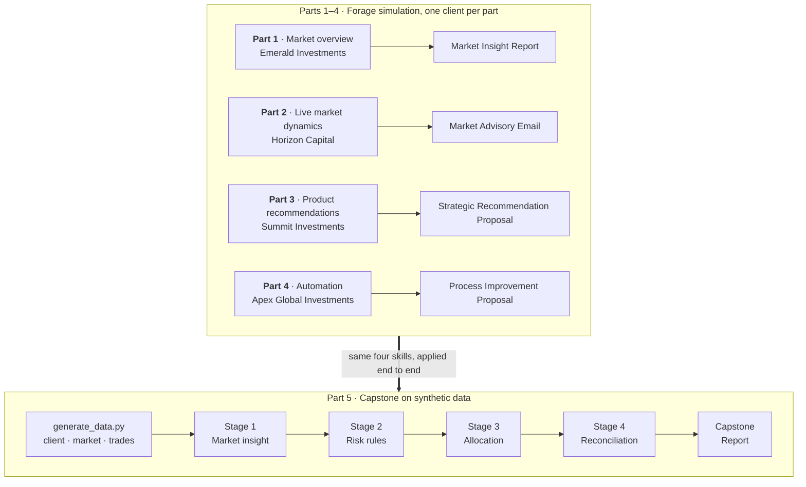
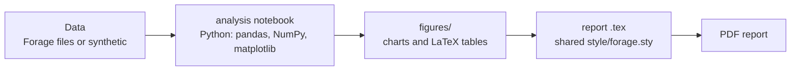

# Global Markets Sales & Trading Analyst — Job Simulation

[](https://github.com/tamezza/Global-Markets-Sales-and-Trading-Analyst/actions/workflows/ci.yml)

My work on the **Bank of America Global Markets Sales and Trading Analyst** virtual job simulation: market analysis, trading decisions, client recommendations and process automation.

**Author:** Thiziri Amezza

**Source:** [Forage — Bank of America, Sales and Trading Analyst](https://www.theforage.com/simulations/bank-of-america/sales-and-trading-analyst-i5jo)

## Highlights

| Part | Client | Key result | Report |
|------|--------|------------|--------|
| 1 · Market overview | Emerald Investments | Technology was 50% of the capital but **91% of the risk**; the proposed mix had **14% lower volatility** and a **32% smaller max drawdown** on the same data | [PDF](01_Market_Overview_Insight_Generation/Market_Insight_Report.pdf) |
| 2 · Live market dynamics | Horizon Capital | Reallocation with explicit triggers: Technology's share of volatility **39% → 30%**, weighted return +0.80% → +1.02% on the snapshot | [PDF](02_Navigating_Live_Market_Dynamics/Market_Advisory_Email.pdf) |
| 3 · Product recommendations | Summit Investments | U.S. large-caps were 45% of the capital but **73% of the risk → 43%**; 17% sustainable allocation, effective holdings 3.1 → 6.1 | [PDF](03_Client_Centric_Product_Recommendations/Strategic_Recommendation_Proposal.pdf) |
| 4 · Automation | Apex Global Investments | Monte Carlo of 10,000 trades: time to execution **63 → 6 min**, reconciliation errors **12% → 2%**, payback 3–11 months | [PDF](04_Automation_Process_Analysis/Process_Improvement_Proposal.pdf) |
| 5 · Capstone | Kestrel Bay Capital (synthetic) | Reconciliation engine: **270/270 breaks found, 0 false alarms**, analyst time −96%; risk triggers cut the chance of breaching the 10% drawdown limit **5.8% → 4.2%** over 5,000 simulated years | [PDF](05_Capstone_Synthetic_Client/Capstone_Report.pdf) |

**Beyond the simulation:** every figure is generated by code and checked automatically on every push (39 tests, reproducibility check). Each part also compares my answer with Forage's example answer. In Parts 1 and 2, the examples' allocations did not add up to 100%.

## What the project does



Every part is built the same way, so each number in a report can be traced back to code:



## Progress

| Part | Topic | Status | Folder |
|------|-------|--------|--------|
| 0 | Intro & scenario | ✅ Done | [00_Intro_Scenario](00_Intro_Scenario/) |
| 1 | Market overview and insight generation | ✅ Done | [01_Market_Overview_Insight_Generation](01_Market_Overview_Insight_Generation/) |
| 2 | Navigating live market dynamics | ✅ Done | [02_Navigating_Live_Market_Dynamics](02_Navigating_Live_Market_Dynamics/) |
| 3 | Client-centric product recommendations | ✅ Done | [03_Client_Centric_Product_Recommendations](03_Client_Centric_Product_Recommendations/) |
| 4 | Innovating through automation or process analysis | ✅ Done | [04_Automation_Process_Analysis](04_Automation_Process_Analysis/) |
| 5 | Capstone: synthetic client, end to end | ✅ Done | [05_Capstone_Synthetic_Client](05_Capstone_Synthetic_Client/) |

Status: ✅ Done · 🔄 In progress · ⏳ To do

## Skills & tools

- **Market analysis:** sector returns, volatility (VIX), interest-rate sensitivity, risk contribution, drawdowns
- **Portfolio construction:** allocation under client constraints, stress tests, Monte Carlo simulation, out-of-sample validation
- **Process automation:** workflow analysis, trade reconciliation engine scored against ground truth
- **Python:** pandas, NumPy, matplotlib, Jupyter; reusable modules in the capstone (`src/`)
- **LaTeX:** client reports built directly from the notebooks' figures and tables

## Repository structure

```
.
├── README.md
├── LICENSE              # MIT (own work; Forage content excluded)
├── requirements.txt     # pinned package versions
├── style/forage.sty      # shared LaTeX style used by every part
├── tests/               # pytest unit tests
├── .github/workflows/   # CI: tests + reproducibility check on every push
├── 00_Intro_Scenario/
├── 01_Market_Overview_Insight_Generation/
├── 02_Navigating_Live_Market_Dynamics/
├── 03_Client_Centric_Product_Recommendations/
├── 04_Automation_Process_Analysis/
└── 05_Capstone_Synthetic_Client/   # own synthetic client and data
```

## Reproduce the analysis

```bash
pip install -r requirements.txt
cd 01_Market_Overview_Insight_Generation
jupyter notebook analysis.ipynb   # writes figures/ used by the report
```

Same for Part 2 (`02_Navigating_Live_Market_Dynamics/analysis.ipynb`), Part 3 (`03_Client_Centric_Product_Recommendations/analysis.ipynb`) and Part 4 (`04_Automation_Process_Analysis/analysis.ipynb`), which need no downloaded data.

The capstone runs entirely on its own synthetic data, which is committed: run the four notebooks `05_Capstone_Synthetic_Client/01`–`04` in order (see its [README](05_Capstone_Synthetic_Client/README.md)).

The Forage datasets are not included (simulation use only): download them into each part's `resources/` folder first.

## Tests and reproducibility

Every push runs an automated check on GitHub ([workflow](.github/workflows/ci.yml), results in the **Actions** tab):

1. **Unit tests** (`tests/`, 39 tests with pytest). They check that the synthetic data is regenerated byte for byte, that the reconciliation engine finds every planted break and ignores harmless ID differences, and that the risk-off allocation always respects the client's limits.
2. **Re-run everything:** regenerate the capstone data, then execute the capstone notebooks and the Part 2–4 notebooks.
3. **Reproducibility check:** the workflow fails if any data file, LaTeX table or findings file differs from the committed version.

Package versions are pinned in `requirements.txt` (Python 3.10). To run the tests locally:

```bash
pip install -r requirements.txt
pytest
```

## Build the PDFs

Each part has its own `.tex` file. Compile from inside its folder:

```bash
cd 00_Intro_Scenario
pdflatex Intro.tex
```

New documents load the shared style with:

```latex
\documentclass[11pt]{article}
\usepackage{../style/forage}
```

## License

Code, reports and the capstone's synthetic data: [MIT](LICENSE). The Forage simulation content (scenario, client profiles, task descriptions) is not covered and belongs to Forage and Bank of America; see the scope note in [LICENSE](LICENSE).

## Disclaimer

This is a personal learning project. The simulation and its scenario belong to Forage and Bank of America; the analysis and solutions in this repository are my own.

The capstone (Part 5) is entirely my own work and uses **synthetic data only**. The client Kestrel Bay Capital, its market, its trades and every figure in it were generated by `05_Capstone_Synthetic_Client/src/generate_data.py`. Any resemblance to a real firm or real market data is coincidental. Nothing in this repository is investment advice.
