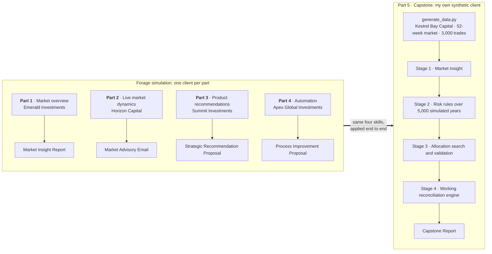
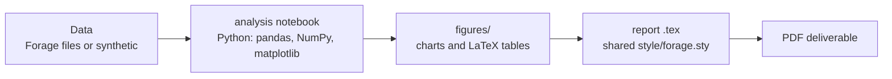

# Global Markets Sales & Trading Analyst — Job Simulation

My work on the **Bank of America Global Markets Sales and Trading Analyst** virtual job simulation: market analysis, trading decisions, client recommendations and process automation.

**Source:** [Forage — Bank of America, Sales and Trading Analyst](https://www.theforage.com/simulations/bank-of-america/sales-and-trading-analyst-i5jo)

## What the project does



Every part is built the same way, so each number in a report can be traced back to code:



## Progress

| Part | Topic | Status | Folder |
|------|-------|--------|--------|
| 0 | Intro & scenario | ✅ Done | [00_Intro_Scenario](00_Intro_Scenario/) |
| 1 | Market overview and insight generation | ✅ Done | [01_Market_Overview_Insight_Generation](01_Market_Overview_Insight_Generation/) |
| 2 | Navigating live market dynamics | ✅ Done | [02_Navigating_Live_Market_Dynamics](02_Navigating_Live_Market_Dynamics/) |
| 3 | Client-centric product recommendations | ✅ Done | [03_Client_Centric_Product_Recommendations](03_Client_Centric_Product_Recommendations/) |
| 4 | Innovating through automation or process analysis | ✅ Done | [04_Automation_Process_Analysis](04_Automation_Process_Analysis/) |
| 5 | Capstone: synthetic client, end to end | ✅ Done | [05_Capstone_Synthetic_Client](05_Capstone_Synthetic_Client/) |

Status: ✅ Done · 🔄 In progress · ⏳ To do

## Skills & tools

- **Market analysis:** sector returns, volatility (VIX), interest-rate sensitivity, risk contribution, drawdowns
- **Portfolio construction:** allocation under client constraints, stress tests, Monte Carlo simulation, out-of-sample validation
- **Process automation:** workflow analysis, trade reconciliation engine scored against ground truth
- **Python:** pandas, NumPy, matplotlib, Jupyter; reusable modules in the capstone (`src/`)
- **LaTeX:** client reports built directly from the notebooks' figures and tables

## Repository structure

```
.
├── README.md
├── style/forage.sty      # shared LaTeX style used by every part
├── 00_Intro_Scenario/
├── 01_Market_Overview_Insight_Generation/
├── 02_Navigating_Live_Market_Dynamics/
├── 03_Client_Centric_Product_Recommendations/
├── 04_Automation_Process_Analysis/
└── 05_Capstone_Synthetic_Client/   # own synthetic client and data
```

## Reproduce the analysis

```bash
pip install -r requirements.txt
cd 01_Market_Overview_Insight_Generation
jupyter notebook analysis.ipynb   # writes figures/ used by the report
```

Same for Part 2 (`02_Navigating_Live_Market_Dynamics/analysis.ipynb`), Part 3 (`03_Client_Centric_Product_Recommendations/analysis.ipynb`) and Part 4 (`04_Automation_Process_Analysis/analysis.ipynb`), which need no downloaded data.

The capstone runs entirely on its own synthetic data, which is committed: run the four notebooks `05_Capstone_Synthetic_Client/01`–`04` in order (see its [README](05_Capstone_Synthetic_Client/README.md)).

The Forage datasets are not included (simulation use only): download them into each part's `resources/` folder first.

## Build the PDFs

Each part has its own `.tex` file. Compile from inside its folder:

```bash
cd 00_Intro_Scenario
pdflatex Intro.tex
```

New documents load the shared style with:

```latex
\documentclass[11pt]{article}
\usepackage{../style/forage}
```

## Disclaimer

This is a personal learning project. The simulation and its scenario belong to Forage and Bank of America; the analysis and solutions in this repository are my own.

The capstone (Part 5) is entirely my own work and uses **synthetic data only**. The client Kestrel Bay Capital, its market, its trades and every figure in it were generated by `05_Capstone_Synthetic_Client/src/generate_data.py`. Any resemblance to a real firm or real market data is coincidental. Nothing in this repository is investment advice.
